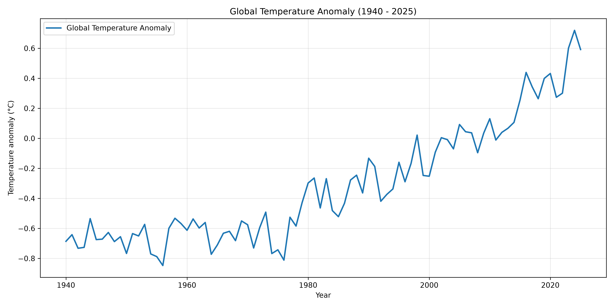
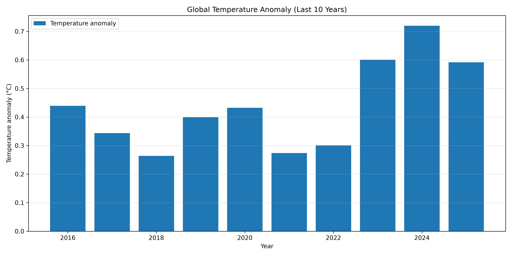

# Global Temperature Anomaly Analysis

## Overview

This project explores global temperature anomalies between 1940 and 2025 using Python.

The analysis uses data from Our World in Data and applies data processing, statistical analysis and data visualisation techniques to identify long-term temperature patterns.

## Technologies

- Python 3.13
- Pandas
- Matplotlib

## Dataset

**Source:** [Our World in Data – Annual Temperature Anomalies](https://ourworldindata.org/grapher/annual-temperature-anomalies)

The dataset contains annual temperature anomaly records for different countries and geographical regions. This project focuses on the global records.

## Analysis

The project includes:

- Dataset exploration and inspection
- Missing value analysis
- Global data filtering
- Mean and median calculations
- Minimum and maximum anomaly identification
- Pearson correlation analysis
- Line chart visualisation
- Bar chart visualisation

## Key Findings

| Metric | Result |
|---|---:|
| Analysis period | 1940–2025 |
| Global records | 86 |
| Mean anomaly | -0.3158 |
| Median anomaly | -0.4310 |
| Lowest anomaly | -0.8475 (1956) |
| Highest anomaly | +0.7195 (2024) |
| Year–anomaly correlation | 0.9089 |

The analysis identifies a strong positive correlation between year and global temperature anomaly, indicating an upward long-term trend.

Correlation does not establish causation.

## Visualisations

### Global Temperature Trend



### Recent Temperature Comparison



## Project Structure

```text
data-analytics/
├── data/
├── src/
│   └── data_analysis.py
├── visualizations/
│   ├── global_temp_anomaly.png
│   └── recent_temperature_comparison.png
└── README.md
```

## Running the Project

Install the required libraries:

```bash
pip install pandas matplotlib
```

Run the analysis:

```bash
python src/data_analysis.py
```

## Purpose

This project demonstrates practical Python skills in data analysis, data cleaning, statistical calculations and visualisation.